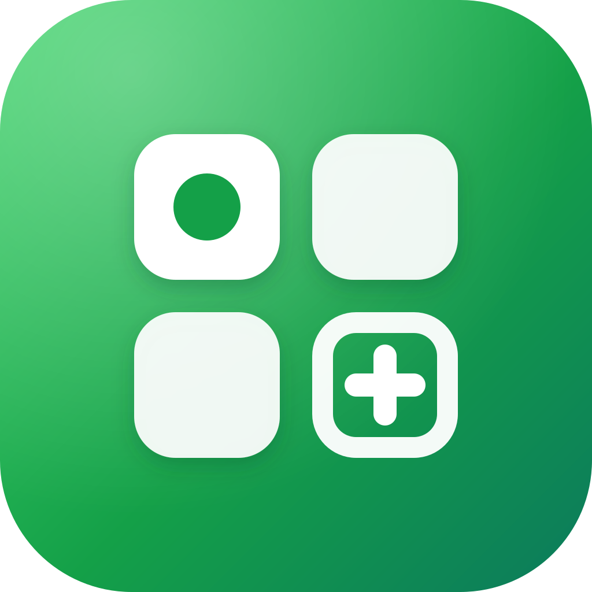
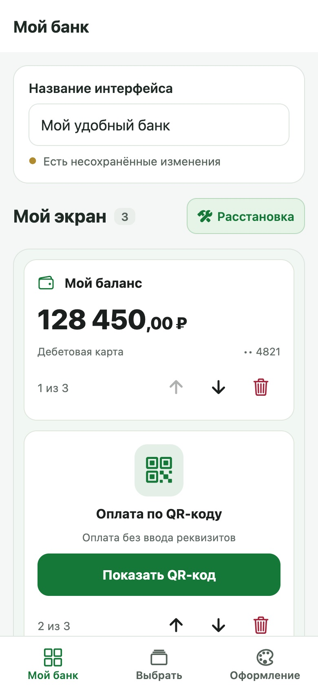
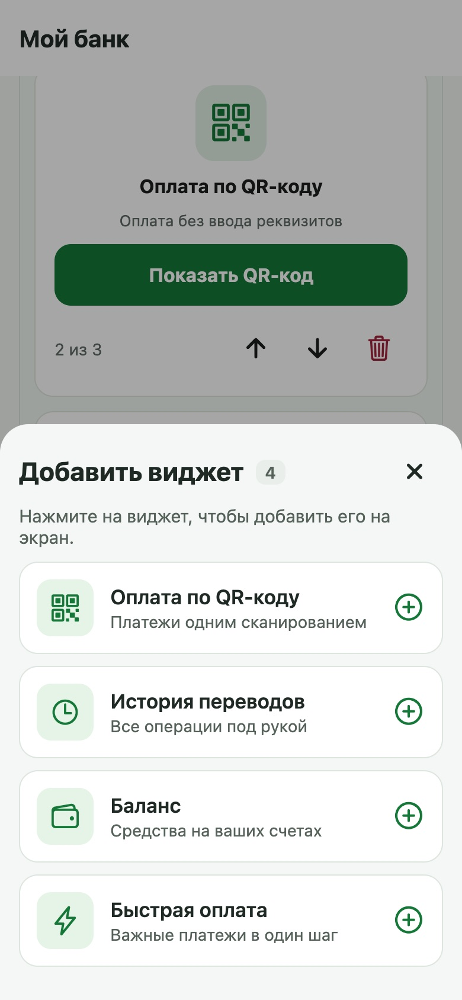
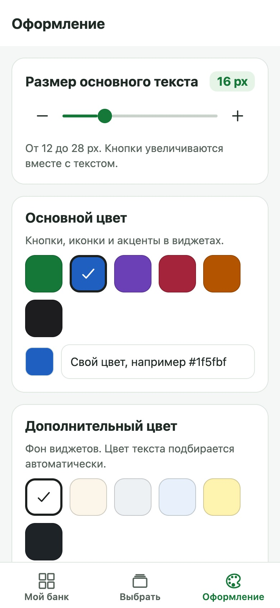
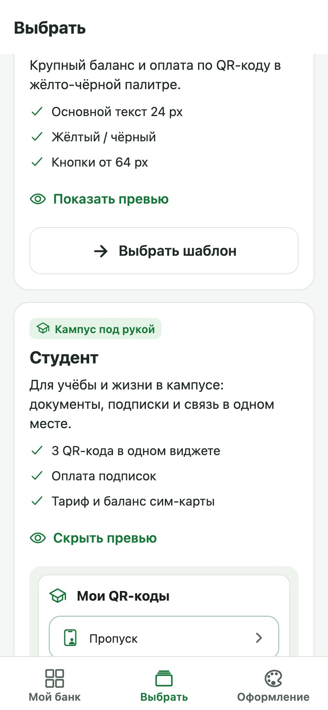

<div align="center">



# Конструктор доступных интерфейсов — мобильное приложение

**Соберите понятный главный экран банка у себя в телефоне: крупные виджеты, свой размер текста и цвета.**

Стартап-проект · Заказчик — Сбер · Статус: рабочий макет


[](https://github.com/TewCorejz/accessible-ui-constructor-mobile/actions/workflows/ci.yml)

Веб-версия для компьютера и планшета: [accessible-ui-constructor](https://github.com/TewCorejz/accessible-ui-constructor) · [демо](https://tewcorejz.github.io/accessible-ui-constructor/)

</div>

---

## 📱 Экраны

<table>
  <tr>
    <td></td>
    <td></td>
    <td></td>
    <td></td>
  </tr>
  <tr>
    <td align="center">Мой банк</td>
    <td align="center">Добавить виджет</td>
    <td align="center">Оформление</td>
    <td align="center">Шаблоны</td>
  </tr>
</table>

## ✨ Что умеет

| Вкладка | Возможности |
|---|---|
| **Мой банк** | Название интерфейса, виджеты во всю ширину экрана, режим расстановки: перетаскивание долгим нажатием, кнопки выше / ниже / удалить, каталог виджетов в выезжающей панели, сохранение |
| **Выбрать** | Сохранённые интерфейсы, импорт из файла (JSON / YAML / XML) с проверкой и превью, новый интерфейс, шаблоны под шторкой с превью по запросу |
| **Оформление** | Размер основного текста 12–28 px (ползунок и кнопки − / +), основной и дополнительный цвет, проверка контраста по WCAG, «Поделиться настройками», «Начать заново» |

Все данные хранятся только на устройстве (AsyncStorage). Формат конфигурации совпадает с веб-версией ([описание](https://github.com/TewCorejz/accessible-ui-constructor/blob/main/docs/config-format.md)) — настройки можно переносить между приложениями.

### Доступность

- цели нажатия не меньше 48 × 48 pt, основные кнопки — 56 pt;
- у всех кнопок есть подписи для VoiceOver и TalkBack, у переключателей — состояние;
- после действий (добавить, переставить, сохранить) приложение озвучивает результат;
- текст учитывает системный размер шрифта телефона (до ×2), экраны не ломаются даже на максимальном размере;
- перестановка виджетов доступна скринридеру через действия «Поднять выше» / «Опустить ниже»;
- цвет текста на фоне виджетов подбирается автоматически, низкий контраст подсвечивается.

## 🚀 Запуск

Нужны **Node.js 22** и приложение **Expo Go** на телефоне ([iOS](https://apps.apple.com/app/expo-go/id982107779) / [Android](https://play.google.com/store/apps/details?id=host.exp.exponent)).

```bash
git clone https://github.com/TewCorejz/accessible-ui-constructor-mobile.git
cd accessible-ui-constructor-mobile
npm install
npx expo start
```

Отсканируйте QR-код из терминала камерой iPhone или приложением Expo Go на Android. Телефон и компьютер должны быть в одной Wi-Fi сети.

| Команда | Что делает |
|---|---|
| `npx expo start` | Dev-сервер, QR-код для Expo Go |
| `npm run ios` / `npm run android` | Открыть в симуляторе iOS / эмуляторе Android |
| `npm run web` | Открыть в браузере (для быстрой проверки) |
| `npm run typecheck` | Проверка типов |
| `npm run lint` | Линтер |

## 🗂 Структура

```
src/
├── app/                 # Экраны (Expo Router): каждая вкладка — файл
│   ├── _layout.tsx      # Нижние вкладки, загрузка сохранённых данных
│   ├── index.tsx        # «Мой банк»
│   ├── choose.tsx       # «Выбрать»: сохранённые и шаблоны
│   └── appearance.tsx   # «Оформление»
├── components/
│   └── WidgetView.tsx   # Содержимое виджетов (демо-данные)
├── lib/
│   ├── model.ts         # Виджеты, шаблоны, расчёт оформления
│   ├── appearance.ts    # Размер текста, палитра, контраст (общий с веб-версией)
│   └── store.tsx        # Состояние приложения и сохранение на устройстве
└── ui/kit.tsx           # Кнопки, карточки, цвета приложения
```

## 🧭 Дорожная карта

- [x] Рабочий макет: три вкладки, виджеты, шаблоны, оформление, сохранение
- [x] Импорт настроек из файла веб-версии (JSON / YAML / XML, вкладка «Выбрать»)
- [x] Перетаскивание виджетов пальцем (долгое нажатие); кнопки «выше» / «ниже» и действия скринридера остаются
- [x] Проверка с максимальным системным шрифтом, доработки для скринридеров — [docs/accessibility.md](docs/accessibility.md)
- [ ] Проверка с VoiceOver и TalkBack на реальных устройствах
- [ ] Сборка через EAS и тестовая раздача (TestFlight / внутреннее тестирование Google Play)

## 📄 Лицензия и правовая информация

© 2026 Команда проекта «Конструктор доступных интерфейсов». Все права защищены — см. [LICENSE](LICENSE).

Проект разрабатывается командой стартапа по заказу Сбера и не является официальным продуктом ПАО Сбербанк. Товарные знаки «Сбер» и «СберБанк» в приложении не используются. Все суммы, карты и операции — вымышленные.
